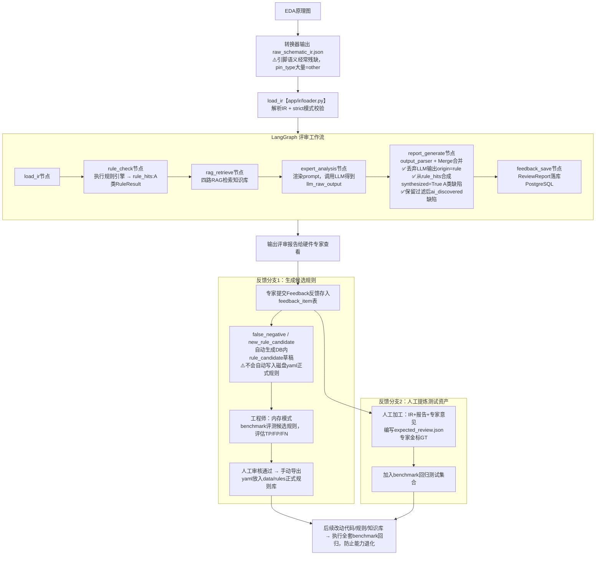
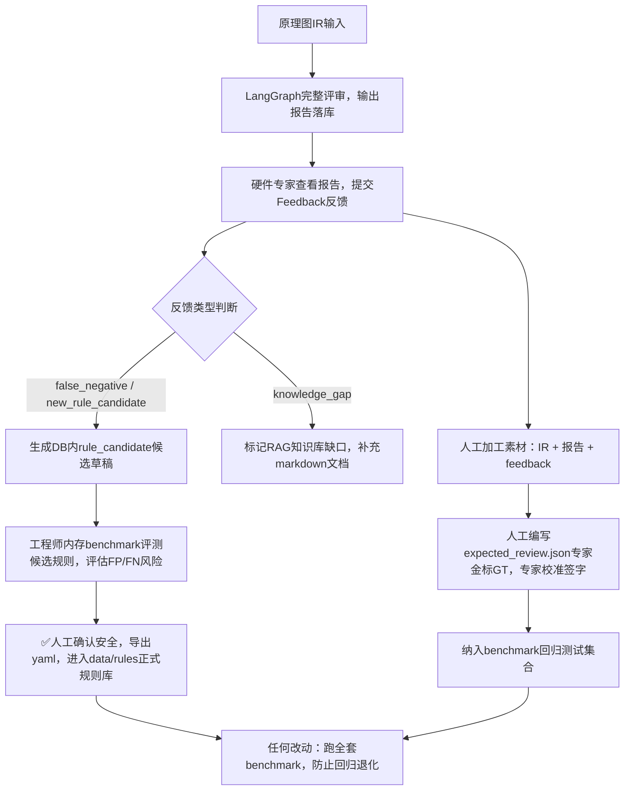
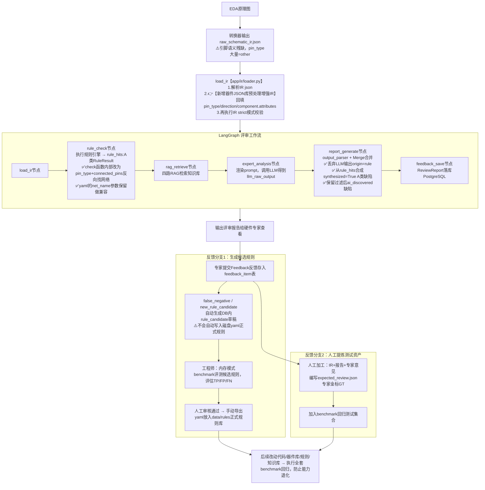

# 原理图AI评审后端｜业务梳理·模块流程·现状与改进方案
> 文档说明：
> 1. 文档包含：系统定位、现有Sprint‑1完整现状（流程图+模块链路）、核心业务概念、迭代闭环；
> 2. 区分：**当前已实现系统流程图** 和 **增加器件JSON参考库后的改进版流程图**；
> 3. 下一步增量改进方案：改动文件、不动文件、约束风险、迭代实施步骤；
> 4. 保存为 `原理图AI评审后端_业务梳理_现状与改进方案.md`，支持Mermaid渲染的编辑器均可打开（VS Code、Typora、Obsidian等）。

## 目录
1. [系统整体定位](#1-系统整体定位)
2. [当前Sprint‑1已实现完整业务流程（现状）](#2-当前sprint‑1已实现完整业务流程现状)
3. [源码模块调用链路（对应上传py源码）](#3-源码模块调用链路对应上传py源码)
4. [核心业务概念说明](#4-核心业务概念说明)
5. [Sprint‑1现有迭代闭环（评审‑反馈‑候选规则‑benchmark回归）](#5-sprint‑1现有迭代闭环评审反馈候选规则-benchmark回归)
6. [现存短板与痛点](#6-现存短板与痛点)
7. [改进后完整业务流程（新增器件JSON参考库预处理）](#7-改进后完整业务流程新增器件json参考库预处理)
8. [下一步增量改进详细方案](#8-下一步增量改进详细方案)
9. [实施步骤建议](#9-实施步骤建议)
10. [关键约束与风险提醒](#10-关键约束与风险提醒)

---

## 1. 系统整体定位
硬件原理图AI评审后端 Sprint‑1
- 输入：`schematic_ir.json`，EDA转换器输出原理图结构化中间表示IR；
- 输出：结构化评审报告缺陷集合，支持专家反馈、候选规则生成、benchmark评测回归；
- **A类缺陷**：拓扑、数值可做确定性判断，由`circuit_checks.py`规则引擎产出；**A类缺陷权威来源为规则引擎，不采信LLM输出结果**。
- **B类缺陷**：无法硬编码判定，依赖datasheet、硬件规范，依靠RAG知识库 + LLM推理，产出`origin=ai_discovered`缺陷。

---

## 2. 当前Sprint‑1已实现完整业务流程（现状）
> ⚠️ 当前版本**无器件JSON参考库预处理模块**，IR引脚语义`pin_type`完全依赖原理图转换器输出，真实场景转换器输出经常大量`pin_type=other`。

> 现状关键说明：
> 1. IR 中 `nets[*].connected_pins` 来自网表，电气连接客观可信；
> 2. `net_name` 为原理图工程师手工命名，不可靠；现有部分规则 yaml 硬编码网络名字（如 `reset_net: "RST"`）；
> 3. case001 样例 IR 中完整 `pin_type` 是人工填写，并非转换器真实产出。

---

## 3. 源码模块调用链路（对应上传 py 源码）

### 3.1 IR 输入层

| 文件 | 职责 |
|---|---|
| `app/ir/schema.py` | `SchematicIRDocument` Pydantic 模型定义，Component / Pin / Net |
| `app/ir/loader.py` | IR json 加载、解析入口 |
| `app/ir/validator.py` | IR strict 严格校验，校验引脚引用合法性 |

### 3.2 A 类规则引擎

| 文件 | 职责 |
|---|---|
| `app/rules/circuit_checks.py` | 全部原子检查函数；统一签名 `(ir, rule_params) → List[RuleHitItem]`；只输出命中位置、message、证据，不含 severity/suggestion |
| `app/rules/registry.py` | 函数注册表，字符串 key 映射 python 函数 |
| `app/rules/engine.py` | 加载 yaml 规则、条件匹配、调用 check 函数；组装 `RuleResult`；`execute_defect_rules()` 过滤 low，评审 & benchmark 统一入口；`execute_defect_rules_with_extra()` 内存加载候选规则，不污染磁盘 |
| `data/rules/*.yaml` | 规则配置文件：rule_id、severity、suggestion、params；不写业务判断逻辑 |

### 3.3 LLM B 类推理链路

| 文件 | 职责 |
|---|---|
| `app/llm/provider.py` | LLM 调用抽象，区分可重试 / 不可重试异常 |
| `app/llm/prompt_renderer.py` | prompt 模板渲染 |
| `app/llm/output_parser.py` | JSON 容错解析、schema 校验、证据校验、过滤重标缺陷、计算 review_status/confidence |

### 3.4 RAG 知识库

| 文件 | 职责 |
|---|---|
| `app/rag/chunking.py` | markdown 语义分块 |
| `app/rag/ingest.py` | 知识库导入 pgvector 向量库 |
| `app/rag/embedding_factory.py` | embedding 维度守卫 |
| `app/rag/retriever.py` | 四路检索逻辑 |

### 3.5 LangGraph 工作流

| 文件 | 职责 |
|---|---|
| `app/workflows/state.py` | `ReviewGraphState` 全流程状态 TypedDict |
| `app/workflows/review_graph.py` | 6 节点 DAG 定义，评审主工作流 |

### 3.6 Service 业务服务层

| 文件 | 职责 |
|---|---|
| `app/services/task_service.py` | 创建任务、查询任务 / 缺陷、对外反馈入口 |
| `app/services/feedback_service.py` | 反馈落库；识别反馈类型，生成 `rule_candidate` 数据库草稿 |
| `app/services/rule_evolution_service.py` | 候选规则管理、内存 benchmark 评测、草稿导出骨架 |
| `app/services/benchmark_service.py` | benchmark 评测核心；读取 `expected_review.json` 金标；Pred 与 GT 贪心匹配；计算 TP/FP/FN/Precision/Recall/EVC；支持 rule_only / full_review 模式，输出 csv 报告 |

### 3.7 持久层

| 文件 | 职责 |
|---|---|
| `app/persistence/models.py` | SQLAlchemy ORM 模型 |
| `alembic/env.py` | alembic 数据库迁移入口，读取 DATABASE_URL 环境变量 |

### 3.8 Schema 数据契约

| 文件 | 职责 |
|---|---|
| `app/schemas/report.py` | ReviewReport / Defect / Evidence Pydantic |
| `app/schemas/feedback.py` | FeedbackCreate / FeedbackOut / RuleCandidate |

---

## 4. 核心业务概念说明

**A 类缺陷 origin="rule"**
- 来源：`circuit_checks.py` 规则引擎；
- Merge 层直接由 `RuleResult` 合成 Defect，标记 `synthesized=True`；丢弃 LLM 输出的 origin=rule 缺陷；
- 证据主要为 `ir_ref` 拓扑证据；适合 benchmark 回归测试。

**B 类缺陷 origin="ai_discovered"**
- 来源：LLM 输出，经过 output_parser 过滤校验；
- 依赖 RAG 的 `rag_ref` 知识库证据；存在大模型随机性。

**expected_review.json（专家金标 GT）**
- 测试资产，评审运行时不读取，仅 benchmark 评测使用；
- 存储该 case 专家标定标准答案缺陷，用来计算 TP/FP/FN，做回归测试；
- ⚠️ 不会自动修复系统，仅用来发现 FP/FN。

**Feedback 反馈**
- 线上业务产物，存入数据库 `feedback_item`；
- 6 种反馈类型：`CORRECT_DEFECT`、`FALSE_POSITIVE`、`FALSE_NEGATIVE`、`SUGGESTION_UPDATE`、`NEW_RULE_CANDIDATE`、`KNOWLEDGE_GAP`。

**rule_candidate**
- 数据库内候选规则草稿；严禁自动写入磁盘正式 yaml 规则库；
- 必须人工审核 + benchmark 评测，确认安全后手动导出上线。

---

## 5. Sprint‑1 现有迭代闭环（评审‑反馈‑候选规则‑benchmark 回归）

---

## 6. 现存短板与痛点

> 当前 Sprint‑1 代码全部可跑通，但存在上游依赖痛点：
1. IR 的引脚语义 `pin_type` 高度依赖原理图 EDA 库质量，真实转换器输出大量 `pin_type=other`；
2. 现有部分规则依靠 `net_name` 网络名字字符串匹配定位复位 / 电源网络；网络名字是工程师手工命名，不可靠；
3. 理想模式：依靠器件标准引脚语义 + connected_pins 客观网表反向定位业务网络，不再依赖网络名字文本；
4. 解决方案：器件 JSON 参考库（增量开发，松耦合，上层业务几乎不动）。

---

## 7. 改进后完整业务流程（新增器件 JSON 参考库预处理）

> ✅ 仅在 IR 加载解析之后、进入 LangGraph 之前新增预处理步骤；后面整套评审、反馈、迭代闭环完全复用现有 Sprint‑1 代码。
> 配置开关 `ENABLE_COMPONENT_LIB`，可一键关闭预处理，回退原有逻辑。

### 器件 JSON 库说明
- 存储形式：一批 JSON 文件，git 版本管理，不存入数据库；
- 每个器件 JSON 包含：`lib_name`、`aliases` 别名列表、`footprint` 封装、`pins` 引脚完整定义、`electrical_spec` 器件固有电气参数；
- 预处理只回填 IR 已有的字段（`pin.pin_type`、`pin.direction`、`component.attributes`），不新增 IR schema 字段。

---

## 8. 下一步增量改进详细方案

### 8.1 改进目标
1. 隔离原理图 EDA 库质量缺陷，不依赖原理图库自带引脚语义标注；
2. 优先通过 `pin_type` 引脚语义 + `connected_pins` 网表反向定位复位、时钟、电源网络，降低对 `net_name` 人工命名的依赖；
3. 新增芯片型号，只维护器件 JSON，不需要修改 Python 业务代码；
4. 完全向后兼容，开关可控，不破坏原有 case 资产。

### 8.2 需要新增的文件
1. 新建模块目录 `app/component_lib/`
    - `__init__.py`
    - `loader.py`：加载器件 JSON、别名匹配逻辑；对外暴露函数：`enhance_ir_with_component_lib(ir) -> SchematicIRDocument`
2. 器件 JSON 资源目录，存放各个芯片 json 定义，git 版本管控。

### 8.3 需要修改的已有文件（改动范围很小）
1. `app/ir/loader.py`
    - IR 解析完成之后、validator 校验之前调用 `enhance_ir_with_component_lib()`；
    - 增加环境开关 `ENABLE_COMPONENT_LIB`，true 开启，false 关闭增强，回退原始逻辑；
    - ✅ 上层 `review_graph` 不需要修改任何代码，预处理在 loader 内部完成。
2. `app/rules/circuit_checks.py`
    - 修改各个 check 函数内部查找业务网络的实现逻辑；优先扫描 `pin_type`，通过 `connected_pins` 反向获取网络；
    - 函数签名 `(ir, rule_params) -> List[RuleHitItem]` 完全不变，输出结构体不变；
    - yaml 传入的 `net_name` 参数保留，作为兼容备选，老 case 无需修改。
3. 少量 yaml 规则：将硬编码网络名字参数改为可选参数，保持向后兼容。

### 8.4 ✅ 完全不需要改动的上层模块（松耦合保证）
> 前提：不修改 `SchematicIRDocument` Pydantic Schema 字段定义，只填充已有字段内容；check 函数入参返回值契约不变。
- `registry.py`、`engine.py` 规则调度
- review_graph 全部 6 节点工作流
- rag 全套模块
- llm 全套、output_parser、merge 逻辑
- task_service / feedback_service / rule_evolution_service
- benchmark_service 评测
- API 接口、schemas、前端、ORM 数据库模型

---

## 9. 实施步骤建议

> 建议：先把现有 Sprint‑1 全流程跑通，benchmark 全部回归通过，再做器件库增量开发。

1. 阶段 1：现有系统验证。跑通 case001 等 A 类 case，benchmark 基线达标。
2. 阶段 2：开发 `app/component_lib` 模块，编写单元测试；接入 `loader.py`，实现开关控制。
3. 阶段 3：改造 `circuit_checks.py` 内部网络查找逻辑，保留 yaml 向后兼容。
4. 阶段 4：pytest 单元测试 + 全套 benchmark 回归，保证原有 case 行为不变。
5. 阶段 5：逐步扩充器件 JSON 库的芯片条目；同步新增 case 金标，扩充回归测试集。

---

## 10. 关键约束与风险提醒

1. 器件 JSON 预处理只回填 IR 已有字段，不新增 IR schema 必填字段，保证上层契约不变。
2. 器件 JSON 库未收录的芯片，无法回填引脚语义；A 类规则识别失效，自动降级交给 B 类 RAG+LLM 做子电路识别。
3. 开关 `ENABLE_COMPONENT_LIB`，出现 bug 一键关闭增强，回退现有系统。
4. `rule_candidate` 数据库草稿，严禁自动写入磁盘正式 yaml 规则，必须人工 + benchmark 双重把关。
5. `expected_review.json` 专家金标是离线测试资产，评审运行时不读取；金标只能发现 FP/FN，不能自动修复系统。
6. A/B 类划分：
    - A 类：IR 信息完备，可以拓扑 / 数值判定，写 `circuit_checks` + yaml；
    - B 类：IR 信息不足，依赖外部 datasheet / 规范，走 RAG+LLM，不新增 `circuit_checks` 检查函数。
#（注：内容由AI生成）
